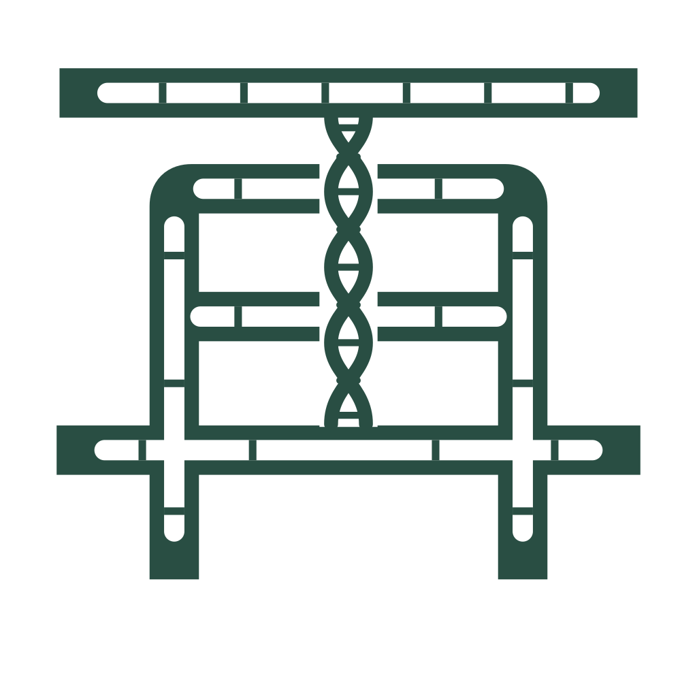

# SaigenBio

**A visual analysis recorder for bioinformaticians working with AI agents.**

Biological analysis increasingly develops through conversation: a researcher asks a question, discusses a plan with an AI agent, inspects the results, and decides what to try next. New questions lead to different parameters, alternative methods, and returns to earlier steps. As agents accelerate this trial and error, the analysis can grow into a complex flow of branches and revisions.

SaigenBio helps manage that exploration for reproducibility. It connects recorded commands, scripts, inputs, outputs, and stated decisions in a visual flow, so researchers can trace how a result was produced and understand what changed between attempts.

Use your preferred AI agent to explore the biology. Use SaigenBio to keep the evolving analysis understandable, inspectable, and ready to share. States contain preserved results; arrows show the actions that produced them.

## What you can do

- Follow analysis as it runs, from a planned output to a completed result.
- Compare branches with different parameters while preserving earlier outputs.
- Inspect figures, table excerpts, commands, inputs, and recorded reasons.
- Record AI-driven analysis or meaningful checkpoints from a human shell session.
- Export selected states and figures through Quarto.

## Start here

SaigenBio requires Python 3.10+. Use your preferred Python environment or application installer.

1. [Install SaigenBio](docs/installation.md).
2. [Open an analysis project](docs/getting-started.md).
3. Optionally [connect your AI agent](docs/agent-integrations.md).

For a guided scientific example, follow the [E. coli tutorial](docs/tutorials/ecoli-exploration.md).

## Documentation

| Goal | Guide |
| --- | --- |
| Choose an installation method | [Installation](docs/installation.md) |
| Set up a project and use the canvas | [Getting started](docs/getting-started.md) |
| Explore real data and compare thresholds | [E. coli tutorial](docs/tutorials/ecoli-exploration.md) |
| Configure an AI agent | [Agent integrations](docs/agent-integrations.md) |
| Record commands, import files, or capture a shell session | [Recording reference](docs/recording.md) |
| Export selected results | [PDF reports](docs/reports.md) |
| Understand provenance and storage | [Architecture](docs/architecture.md) |
| Use the logo or favicon | [Branding assets](docs/branding.md) |
| Develop or contribute | [Contributing](CONTRIBUTING.md) |

## Current scope

SaigenBio runs locally. It preserves declared files and observed process facts; it does not automatically discover every dependency or establish scientific correctness. Existing files can be imported, but their prior execution is not reconstructed.

Workspace setup is available for Codex, Claude Code, OpenCode, and Antigravity. Setup validation and live-agent validation are different; see the integration guide for current evidence and limitations. Hosted collaboration, automatic notebook capture, and environment replay are not implemented.

Report bugs and propose improvements through [GitHub Issues](https://github.com/khan-lab/SaigenBio/issues).
