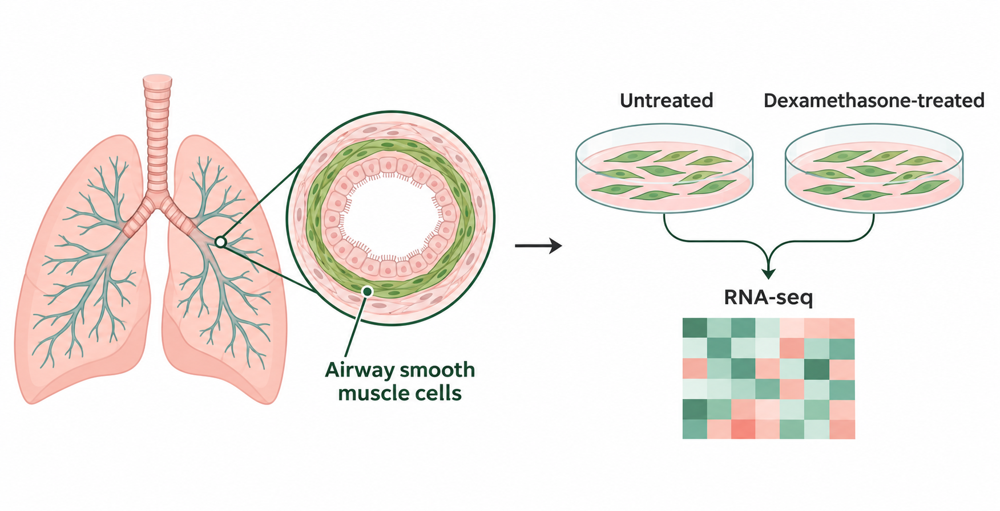

# Follow an airway RNA-seq analysis with SaigenBio

Which genes changed expression after dexamethasone treatment, and which biological processes show coordinated changes? Use the public Bioconductor `airway` dataset to follow that question from gene counts to a pathway summary, then find a published workflow for the same inputs. The dataset contains gene counts from four human airway smooth muscle cell lines, each measured with and without treatment. [Bioconductor dataset and study](https://bioconductor.org/packages/release/data/experiment/vignettes/airway/inst/doc/airway.html)



*Study overview. The heatmap is a schematic illustration.*

## 1. Initialize the project

[Install or update SaigenBio](../installation.md). Choose an empty workspace outside the SaigenBio source checkout and open it in VS Code. If you need to create the folder, replace the example path with a location you choose.

```sh
mkdir -p "/path/to/your/project" && cd "/path/to/your/project"
```

From a terminal in the workspace, run the interactive setup to choose the project name, agent, and viewer settings.

```sh
saigen init
```

**Optional.** If you already know the project name or agent, pass `--name` or `--agent` when you run `saigen init`. Agent values are `codex`, `claude` (Claude Code), `opencode`, and `antigravity`. For example, you can run `saigen init --name "Airway RNA-seq" --agent codex`.

Start the viewer during setup, or run `saigen serve` later from this folder. Open the viewer URL and start a fresh agent session in the same workspace. Use a second terminal for any commands below if the viewer is running in the first one.

Before recording the demo, prepare the packages in the R environment that your terminal's `Rscript` uses.

```r
if (!requireNamespace("BiocManager", quietly = TRUE)) {
  install.packages("BiocManager")
}
BiocManager::install(c("airway", "DESeq2", "fgsea"))
install.packages("msigdbr")
```

## 2. Show gene counts and sample metadata

Run this in R with the project folder as your working directory. The first printed table shows a few genes across all samples. The second shows the sample ID, cell line, and treatment. `trt` means dexamethasone-treated and `untrt` means untreated.

```r
data("airway", package = "airway")
counts <- SummarizedExperiment::assay(airway)
metadata <- as.data.frame(SummarizedExperiment::colData(airway))
stopifnot(identical(colnames(counts), rownames(metadata)))
samples <- data.frame(sample = rownames(metadata), metadata[c("cell", "dex")])
head(counts)
print(samples)
print(with(samples, table(cell, dex)))

dir.create("inputs", showWarnings = FALSE)
count_table <- data.frame(gene_id = rownames(counts), counts, check.names = FALSE)
write.table(count_table, "inputs/counts.tsv", sep = "\t", row.names = FALSE, quote = FALSE)
write.csv(samples, "inputs/samples.csv", row.names = FALSE)
```

From the terminal, add the tables to the Canvas. Open each card to show how the sample IDs in the metadata match the columns in the counts.

```sh
saigen snapshot --id counts --title "Airway gene counts" --file inputs/counts.tsv \
  --note "Processed gene counts exported from the Bioconductor airway package."
saigen snapshot --id samples --title "Airway sample metadata" --file inputs/samples.csv \
  --note "Four cell lines measured with and without dexamethasone."
```

## 3. Compare gene expression with DESeq2

> Compare dexamethasone-treated and untreated samples. Account for the paired cell lines. Show the proposed step before running it, and save the full result table and one plot.

Save the following as `deseq.R`. The design `~ cell + dex` accounts for differences among cell lines. The contrast is treated relative to untreated, so positive log₂ fold changes indicate higher estimated expression after treatment. Keep the full table for ranking genes in the next step. [Bioconductor paired DESeq2 example](https://www.bioconductor.org/help/course-materials/2019/CSAMA/materials/labs/lab-03-rnaseq/rnaseqGene_CSAMA2019.html)

```r
library(DESeq2)

args <- commandArgs(trailingOnly = TRUE)
counts <- as.matrix(read.delim(args[1], row.names = 1, check.names = FALSE))
samples <- read.csv(args[2], row.names = "sample")
stopifnot(setequal(colnames(counts), rownames(samples)))
samples <- samples[colnames(counts), , drop = FALSE]
samples$cell <- factor(samples$cell)
samples$dex <- factor(samples$dex, levels = c("untrt", "trt"))
stopifnot(!anyNA(samples$dex), all(with(samples, table(cell, dex)) == 1))

dds <- DESeq(DESeqDataSetFromMatrix(counts, samples, design = ~ cell + dex))
result <- results(dds, contrast = c("dex", "trt", "untrt"), alpha = 0.05)
write.csv(as.data.frame(result), "deseq2.csv")
png("ma-plot.png", width = 1000, height = 650)
plotMA(result, alpha = 0.05, main = "Dexamethasone-treated vs untreated")
invisible(dev.off())
```

After reviewing the proposed comparison, have the agent record the run or run the following yourself.

```sh
saigen run --id deseq --from counts --from samples --title "Paired DESeq2 comparison" \
  --reason "Estimate the treatment effect while accounting for cell line." \
  --input inputs/counts.tsv --input inputs/samples.csv --script deseq.R \
  --output deseq2.csv --output ma-plot.png \
  -- Rscript "{project}/deseq.R" "{input:0}" "{input:1}"
```

## 4. Run gene set enrichment analysis

> Using the DESeq2 results, test whether genes from the same biological processes tend to rank together. Record the exact gene-set release and save the full enrichment table.

Prepare the human Hallmark gene sets before recording. The following R code writes Ensembl IDs and preserves the MSigDB release in the table. The package may download the gene-set database on first use. [msigdbr documentation](https://igordot.github.io/msigdbr/articles/msigdbr-intro.html)

```r
hallmark <- msigdbr::msigdbr(species = "Homo sapiens", collection = "H")
members <- unique(hallmark[c("gs_name", "ensembl_gene", "db_version")])
members <- members[!is.na(members$ensembl_gene) & nzchar(members$ensembl_gene), ]
print(unique(members$db_version))
write.table(members, "inputs/hallmark.tsv", sep = "\t", row.names = FALSE, quote = FALSE)
```

```sh
saigen snapshot --id hallmark --title "Human Hallmark gene sets" \
  --file inputs/hallmark.tsv --note "MSigDB release recorded in the db_version column."
```

Save this as `gsea.R`. Rank genes with valid test results by their signed Wald statistic and test Hallmark gene sets in that ranking. [Preranked GSEA with fgsea](https://bioconductor.org/packages/release/bioc/vignettes/fgsea/inst/doc/fgsea-tutorial.html)

```r
args <- commandArgs(trailingOnly = TRUE)
deg <- read.csv(args[1], row.names = 1)
sets <- read.delim(args[2], stringsAsFactors = FALSE)
eligible <- is.finite(deg$stat) & is.finite(deg$pvalue)
ranks <- sort(setNames(deg$stat[eligible], rownames(deg)[eligible]), decreasing = TRUE)
pathways <- split(sets$ensembl_gene, sets$gs_name)
stopifnot(length(intersect(names(ranks), unlist(pathways))) > 0)
set.seed(42)
gsea <- fgsea::fgseaMultilevel(pathways, ranks, minSize = 15, maxSize = 500, nproc = 1)
result <- as.data.frame(gsea)
result$leadingEdge <- vapply(result$leadingEdge, paste, character(1), collapse = ";")
write.csv(result[order(result$padj), ], "hallmark-gsea.csv", row.names = FALSE)
```

Use `saigen flow` to find the artifact ID for `deseq2.csv`, or ask the agent to resolve it. Replace `DESEQ_ARTIFACT_ID` in the command with that ID.

```sh
saigen run --id gsea --from deseq --from hallmark --title "Hallmark GSEA" \
  --reason "Look for coordinated expression changes across gene sets." \
  --input artifact:DESEQ_ARTIFACT_ID --input inputs/hallmark.tsv --script gsea.R \
  --output hallmark-gsea.csv \
  -- Rscript "{project}/gsea.R" "{input:0}" "{input:1}"
```

## 5. Change the cutoff and compare

> Summarize the GSEA results at FDR 10%, then redo the summary at 5% as a separate branch. Reuse the same result table and show which gene sets pass each cutoff.

Save this as `summarize-gsea.R`. Each summary shows up to eight gene sets by adjusted p-value and retains the full filtered table. Positive normalized enrichment scores indicate concentration toward the treated end of the ranking. Negative scores indicate concentration toward the untreated end.

```r
args <- commandArgs(trailingOnly = TRUE)
result <- read.csv(args[1])
cutoff <- as.numeric(args[2])
stopifnot(is.finite(cutoff), cutoff > 0, cutoff < 1)
keep <- result[!is.na(result$padj) & result$padj <= cutoff, ]
write.csv(keep, "pathways.csv", row.names = FALSE)
top <- head(keep[order(keep$padj, keep$pathway), ], 8)
png("pathways.png", width = 1100, height = 560)
title <- sprintf("%d gene sets at FDR ≤ %.0f%%", nrow(keep), 100 * cutoff)
if (nrow(top)) {
  par(mar = c(4, 19, 3, 1))
  labels <- sub("^HALLMARK_", "", top$pathway)
  values <- rev(top$NES)
  barplot(values, names.arg = rev(labels), horiz = TRUE, las = 1,
          col = ifelse(values > 0, "#3F7365", "#60789D"),
          main = title, xlab = "Normalized enrichment score")
  abline(v = 0)
} else {
  plot.new()
  title(main = title)
}
invisible(dev.off())
```

Replace `GSEA_ARTIFACT_ID` with the recorded ID for `hallmark-gsea.csv` before running this block.

```sh
for cutoff in 0.10 0.05; do
  saigen run --from gsea --title "Hallmark summary at FDR $cutoff" \
    --reason "Compare which gene sets pass this reporting cutoff." \
    --input artifact:GSEA_ARTIFACT_ID --script summarize-gsea.R \
    --output pathways.csv --output pathways.png \
    -- Rscript "{project}/summarize-gsea.R" "{input:0}" "$cutoff" || break
done
```

Both branches use the same estimates and adjusted p-values. Every gene set at 5% should also appear at 10%. Compare what changes without treating a cutoff as a biological boundary.

## 6. Find a published nf-core workflow

Select the **Airway gene counts** and **Airway sample metadata** nodes on the Canvas, choose **Copy node IDs**, and send the IDs with this prompt.

> `$saigen-find-workflow` Find a published workflow that can use these gene counts and sample metadata. Can it compare treated and untreated samples while accounting for cell line, and can it include gene set enrichment?

`nf-core/differentialabundance` is a candidate. It can take the count matrix and samplesheet and accepts a contrasts file to define the paired comparison. For a CSV contrast, use:

```csv
id,variable,reference,target,blocking
dex_trt_vs_untrt,dex,untrt,trt,cell
```

Ask the agent to identify the exact release, check its sample and gene ID fields, and explain the requirements for the gene-set input. The demo ends at the recommendation. Stage-by-stage Canvas tracking for this exact nf-core configuration still needs verification. [nf-core usage guide](https://nf-co.re/differentialabundance/latest/docs/usage/) · [SaigenBio’s Nextflow adapter](../nextflow.md)

## Show it in 90 seconds

| Time | On screen |
| --- | --- |
| 0:00–0:20 | Show the initialized Canvas and the two inputs. Point out one treated and untreated pair. |
| 0:20–0:45 | Open the DESeq2 plot and briefly show the recorded design and inputs. |
| 0:45–1:15 | Show the GSEA result and its two cutoff branches. Open one branch and point to the shared source table. |
| 1:15–1:30 | Show the agent's nf-core recommendation from those same inputs. |

Prepare the project and results before recording. Keep the run details visible long enough for viewers to read them.
